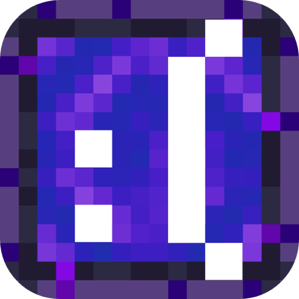

# NEOSkins Viewer

<figure><figcaption></figcaption></figure>

NEOSkins Viewer es el visor 3D de skins de NEOLauncher, empaquetado para usarlo en cualquier web o launcher con interfaz web. Incluye un cliente de la API de NEOSkins para leer y cambiar skins y capas.

<table data-view="cards"><thead><tr><th></th><th></th><th data-hidden data-card-target data-type="content-ref"></th></tr></thead><tbody><tr><td><strong>Instalación</strong></td><td>Cuatro formas de añadirlo a tu proyecto, paso a paso.</td><td><a href="guia/instalacion.md">instalacion.md</a></td></tr><tr><td><strong>Demo</strong></td><td>Pruébalo en el navegador sin instalar nada.</td><td><a href="guia/demo.md">demo.md</a></td></tr><tr><td><strong>Descargas</strong></td><td>Archivo único, paquete npm y código fuente.</td><td><a href="guia/descargas.md">descargas.md</a></td></tr><tr><td><strong>API de NEOSkins</strong></td><td>Referencia HTTP para cualquier lenguaje.</td><td><a href="guia/api.md">api.md</a></td></tr></tbody></table>

## Qué incluye

* **Visor 3D.** Una clase, un contenedor y una URL. Se gira arrastrando.
* **Contorno y antialiasing.** Borde estilo Bedrock por shader, FXAA y supermuestreo.
* **Capas animadas.** PNG o GIF, en tamaño normal, HD o cuadradas.
* **Animaciones.** Reposo en bucle, gestos aleatorios y reacciones al cambiar skin o capa.
* **Cliente de la API.** Leer texturas, subir skins, equipar NEOCapes y verificar cuentas con Discord.

## En treinta segundos

```html
<div id="skin" style="width: 300px; height: 420px"></div>

<script src="https://elmiguelki.github.io/neoskins-viewer/downloads/neoskins-viewer.standalone.js"></script>
<script>
  const viewer = new NeoSkins.NeoSkinViewer("#skin");
  const client = new NeoSkins.NeoSkinsClient({ baseUrl: "https://neobeta.miguelki.ovh" });
  viewer.loadPlayer(client, "Notch");
</script>
```

Eso muestra la skin y la capa que el servidor NEO tiene para ese jugador.

## Qué necesitas


El visor necesita una interfaz web con WebGL: una página, Electron, Tauri o cualquier webview. Si tu launcher es nativo, el visor no te sirve, pero la [API de NEOSkins](guia/api.md) sí.


## Licencia

NEOSkins Viewer se publica con licencia [MIT](https://github.com/elmiguelki/neoskins-viewer/blob/main/LICENSE). Puedes usarlo en proyectos públicos y comerciales. A cambio hay que dar crédito: mantén el aviso de copyright y el texto de la licencia junto a tu copia de la librería. Una mención a NEOSkins Viewer en los créditos de tu aplicación es bienvenida.
